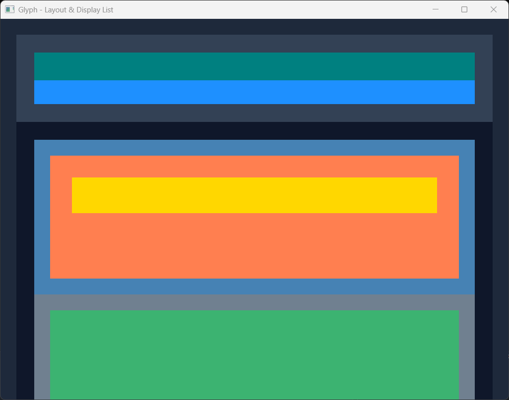

# Glyph

  [](#) [](#) [](#)

## Table of Contents

---

- [About](#about)
- [Pipeline Overview](#pipeline-overview)
- [Current Capabilities](#current-capabilities)
- [Roadmap](#roadmap)
- [ShowCase](#showcase)

## About

---

**Glyph** is a lightweight C++20 browser engine built from scratch that parses HTML and CSS, computes block box layout, builds a display list, and renders rectangles using an **SDL3** backend.

## Pipeline Overview

---

Glyph processes documents through a multi-stage pipeline:

1. **HTML Tokenizer & Parser → DOM:** Reads an HTML file and constructs a tree of DOM nodes.
2. **CSS Parser → StyleSheet:** Parses rules, selectors, and declarations (such as `display`, `padding`, and named/hex `background` colors) into a stylesheet.
3. **Style Tree:** Matches stylesheet rules against DOM nodes to resolve computed values and build a styled tree.
4. **Layout Tree:** Prunes `display: none` nodes, routes block and inline boxes, and computes box-model dimensions and positions (`x`, `y`, `width`, `height`, `padding`, `margin`, `border`) relative to the containing block.
5. **Display List & SDL3 Rendering:** Collects flat draw commands (such as `SolidColor`) into a `DisplayList` and replays them through the SDL3 renderer (`SDL_RenderFillRect`).

## Current Capabilities

---

- Nested `display: block` layout and vertical child accumulation
- `display: none` element exclusion during layout tree construction
- Pixel length parsing (`px`) for padding and box dimensions
- Named CSS colors and hex color parsing (`#rgb`, `#rgba`, `#rrggbb`, `#rrggbbaa`)
- SDL3 window and 2D renderer backend

## Roadmap

---

- [ ] Text nodes, inline layout, and font rendering
- [ ] Support for more attributes and HTML elements such as `img`, `h1`, `h2`, `p`, `ul` and `li`
- [ ] Custom software rectangle rasterizer ahead of or alongside SDL3 rendering
- [ ] Margins, borders, and explicit width/height constraints

## ShowCase

---

Text nodes are not rendered by Glyph yet, so this example uses empty `<div>` elements to test nested block containers, padding insets, named and hex background colors, and `display: none` pruning.

```html
<div class="canvas">
	<div class="header">
		<div class="brand"></div>
		<div class="nav-slot"></div>
	</div>
	<div class="main">
		<div class="panel-primary">
			<div class="card">
				<div class="card-inner"></div>
			</div>
			<div class="card"></div>
		</div>
		<div class="panel-secondary">
			<div class="swatch"></div>
			<div class="swatch"></div>
			<div class="swatch"></div>
		</div>
	</div>
	<div class="footer"></div>
	<div class="unused"></div>
</div>
```

```css
.canvas { display: block; padding: 32px; background: #1e293b; }

.header { display: block; padding: 36px; background: #334155; }

.brand { display: block; padding: 28px; background: teal; }

.nav-slot { display: block; padding: 24px; background: dodgerblue; }

.main { display: block; padding: 36px; background: #0f172a; }

.panel-primary { display: block; padding: 32px; background: steelblue; }

.card { display: block; padding: 44px; background: coral; }

.card-inner { display: block; padding: 36px; background: gold; }

.panel-secondary { display: block; padding: 32px; background: slategray; }

.swatch { display: block; padding: 36px; background: mediumseagreen; }

.footer { display: block; padding: 48px; background: rebeccapurple; }

.unused { display: none; padding: 100px; background: hotpink; }
```

